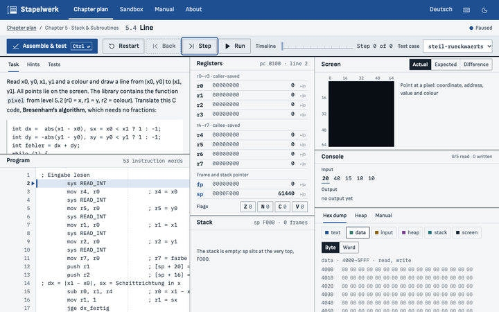
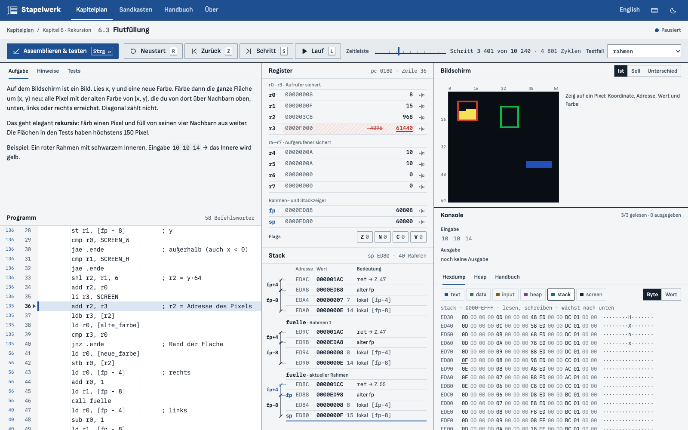
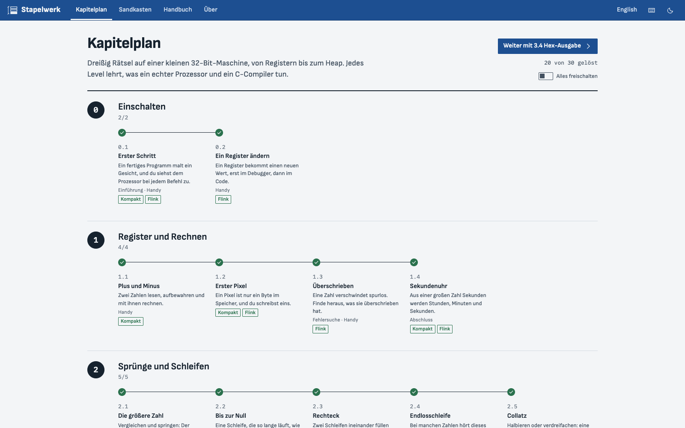
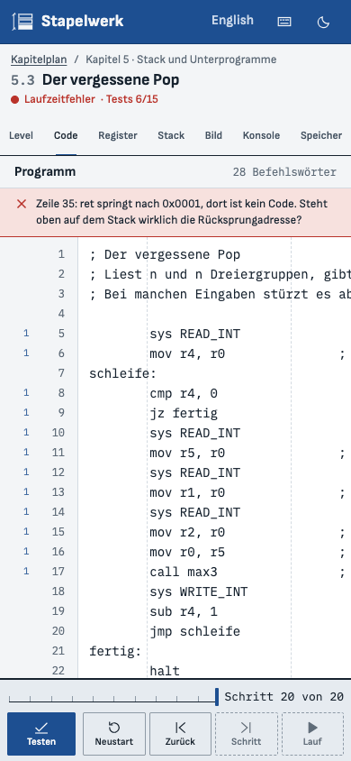

# Stapelwerk

**Assembler-Rätsel im Browser, auf einer eigenen kleinen 32-Bit-CPU.**

Dreißig Rätsel in acht Kapiteln führen vom Ändern eines einzigen Registers bis zu verketteten Listen auf dem Heap. Du schreibst Assembler, lässt ihn gegen Tests laufen und gehst ihn in einem Debugger durch, der auch rückwärts kann. Jedes Level endet damit, was ein echter x86-, ARM- oder RISC-V-Prozessor und ein C-Compiler in derselben Lage tun.

[English version → README.md](README.md)



**[▶ Im Browser spielen](https://stefanpaun.page/stapelwerk/)** (ohne Installation, ohne Konto) · [englische Fassung des Spiels](https://stefanpaun.page/stapelwerk/en/)

- Läuft im Browser, ohne Konto, ohne Installation, nach dem ersten Besuch auch offline.
- Eine selbst entworfene CPU in Rust, ohne fremde Crates, als WebAssembly übersetzt.
- Vanilla-JavaScript und handgeschriebenes CSS: kein Framework, kein Bundler, keine npm-Pakete.

## Was du lernst

Ein Kapitel öffnet sich, sobald die Pflicht-Levels der Kapitel davor gelöst sind. Bonus-Levels sind freiwillig.

| Kapitel | Levels | Begriffe |
|---|---|---|
| 0 · Einschalten | Erster Schritt · Ein Register ändern | Register, Befehlszähler, Einzelschritt, Schritt zurück, Haltepunkt |
| 1 · Register und Rechnen | Plus und Minus · Erster Pixel · Überschrieben · Sekundenuhr | Systemaufrufe, Zwei-Operanden-Form, Bildschirm als Speicher, ganzzahlige Division und Rest |
| 2 · Sprünge und Schleifen | Die größere Zahl · Bis zur Null · Rechteck · Endlosschleife · Collatz | `cmp`, Flags Z/N/C/V, bedingte Sprünge, Schleifen, Endmarke, verschachtelte Schleifen, Zyklenbudget |
| 3 · Bits und Zahlen | Einsen zählen · 8×8-Zeichen · Halbe Wahrheit · Hex-Ausgabe | Masken, Shifts, Zweierkomplement, logischer und arithmetischer Shift, ASCII |
| 4 · Speicher | Größter Wert · Spiegelbild · Einer zu viel · Sortieren | Datensegment, Arrays, Basis + Index·4, Ausrichtung, Little-Endian, Off-by-one |
| 5 · Stack und Unterprogramme | Rückwärts · Pixel als Funktion · Der vergessene Pop · Linie | push/pop, `call`/`ret`, Rücksprungadresse, Aufrufkonvention, caller- und callee-saved |
| 6 · Rekursion | Fakultät · Falscher Fibonacci · Flutfüllung · Türme von Hanoi | Stack-Rahmen, Rahmenzeiger, Prolog und Epilog, Rekursionstiefe, Stack-Überlauf |
| 7 · Heap und Listen | Kettenglieder · Nach dem Freigeben · Sortiert einfügen | `ALLOC`/`FREE`, Zeiger, Nullzeiger, Speicherleck, Zugriff nach dem Freigeben |

Sieben Levels sind **Debugging-Levels**: Der Startcode hat einen Fehler, und du findest ihn mit dem Debugger statt durch Raten. Jedes Level hat eine Aufgabe, drei Hinweise (von der Idee bis fast zur Lösung), sichtbare und verdeckte Tests und eine Seite „Was du gerade gelernt hast“. Der ganze Plan mit Lernzielen steht (englisch) in [docs/CURRICULUM.md](docs/CURRICULUM.md).

## Was du siehst

| | |
|---|---|
| **Editor** | Schlichter Texteditor mit Zeilennummern, Haltepunkten am Rand, Fehlermarken mit Ursache und Stelle und einem Zähler pro Zeile, wie oft sie gelaufen ist. |
| **Debugger mit Zeitreise** | Schritt, Schritt zurück (auch nach einem Fehler), Lauf und Pause, Neustart, eine Zeitleiste zu jedem schon gegangenen Schritt, Haltepunkte und „zurück bis zur letzten Änderung“ für jedes Register. |
| **Register** | `r0`–`r7`, `fp`, `sp`, `pc` und die Flags. Was ein Schritt geändert hat, ist schraffiert und unterstrichen, der alte Wert steht durchgestrichen daneben. Im Pausenzustand lassen sich Werte ändern. |
| **Stack mit Rahmen** | Der Stack als Tabelle von oben bis `sp`, mit der Rahmenkette: altes `fp`, Rücksprungadresse, Argumente, lokale Variablen. |
| **Bildschirm** | Der 64×64-Bildschirm in drei Ansichten: Ist, Soll und Unterschied (falsche Pixel schraffiert). Zeigst du auf ein Pixel, siehst du Koordinate, Adresse und Farbe. |
| **Hexdump** | Alle 64 KiB nach Segmenten, als Bytes oder Wörter; die Heap-Füllmuster `CD`/`DD` sind sichtbar. |
| **Heap-Karte** | Jedes 4-Byte-Stück des Heaps als frei, belegt, freigegeben oder Schutzzone, dazu eine Liste der Blöcke mit der Zeile, die sie angefordert hat. |
| **Handbuch** | Elf kurze Themen (Register, Befehle, Flags, Zweierkomplement, Speicher, Stack, Aufrufkonvention, Heap, Bildschirm, Systemaufrufe, Debugger), verlinkt aus den Level-Texten. |
| **Sandkasten** | Ein freies Programm ohne Aufgabe, mit Eingabe während des Laufs und fünf Beispielen. |
| **Teilen-Link** | Ein Sandkasten-Programm reist komprimiert im Link mit. Nichts wird hochgeladen, und ein geöffneter Link startet nie von selbst. |
| **Ergebnis** | Deine Zyklen und deine Größe im Vergleich zur Referenzlösung, zwei Abzeichen (Kompakt, Flink) und drei Plätze pro Level, um Lösungen aufzuheben. |

<p>
  
  
</p>



## Für Lehrkräfte

- Kein Konto, keine Anmeldung, keine Datensammlung. Der Fortschritt bleibt im Browser der Schülerin oder des Schülers und lässt sich als Datei exportieren.
- Funktioniert offline, sobald die Seite einmal geöffnet war, und läuft auch als lokale Kopie (siehe unten).
- **Alles freischalten** im Kapitelplan öffnet alle Levels auf einmal, etwa um eines am Beamer zu zeigen. Jedes Level hat einen eigenen Link, zum Beispiel `https://stefanpaun.page/stapelwerk/#/level/2-2-bis-zur-null`.
- Die Level-Dateien samt Referenzlösungen und verdeckten Tests liegen offen in diesem Repository. Stapelwerk ist ein Übungswerkzeug, kein Prüfungswerkzeug.

## Lokal starten

Du brauchst [rustup](https://rustup.rs) und Node 22 oder neuer. `npm install` ist nicht nötig, es gibt keine Pakete. `rust-toolchain.toml` legt Rust 1.99.1 mit dem Ziel `wasm32-unknown-unknown` fest; rustup installiert das beim ersten Aufruf.

```sh
git clone https://github.com/Stefan-Paun/stapelwerk.git
cd stapelwerk
npm start          # baut Kern und Seite, startet http://127.0.0.1:4860/stapelwerk/
```

Die englische Fassung liegt unter `http://127.0.0.1:4860/stapelwerk/en/`. Lokal ist der Service Worker (Offline-Modus) aus, außer du hängst `?sw=1` an.

```sh
npm test               # Rust-Tests und Node-Tests
npm run test:browser   # Browser-Tests in Headless Chrome (CHROME_PATH setzen, falls er nicht gefunden wird)
npm run check          # alles, was die CI prüft, mit Zusammenfassung
```

Das Kommandozeilenwerkzeug führt Programme und Levels ohne Browser aus:

```sh
cargo run -q -p stapelwerk-cli -- run loesung.s --level levels/2-2-bis-zur-null.lvl
cargo run -q -p stapelwerk-cli -- run loesung.s --level levels/2-2-bis-zur-null.lvl --test grundfall --trace
cargo run -q -p stapelwerk-cli -- --help
```

## Die Maschine

Eine Lehr-CPU, eigens für dieses Spiel entworfen, klein genug für einen Nachmittag:

- **Register:** 10 × 32 Bit, `r0`–`r7`, `fp` (Rahmenzeiger) und `sp` (Stackzeiger). Der Befehlszähler ist kein Operand.
- **Flags:** Z, N, C, V. C nach einer Subtraktion bedeutet *Borgen*, wie bei x86.
- **Befehle:** 47 Mnemonics auf 51 Opcodes, jeder genau ein 32-Bit-Wort in einem von vier festen Formaten. Die Dekodierung ist streng: Jedes gültige Wort hat genau eine Bedeutung und eine Textform.
- **Präzise Fehler:** 23 benannte Laufzeitfehler (Nullzugriff, falsch ausgerichtetes Wort, Stack-Überlauf, Zugriff nach dem Freigeben, …), jeder mit einer Erklärung auf Deutsch und Englisch.
- **Bildschirm:** 64×64 Pixel, ein Byte pro Pixel ab `0xF000`, 16 benannte Farben.
- **Systemaufrufe:** 8 (`READ_INT`, `WRITE_INT`, `READ_CHAR`, `WRITE_CHAR`, `WRITE_STR`, `ALLOC`, `FREE`, `RAND`).
- **Deterministisch:** keine Gleitkommazahlen, keine Uhr, Zufall nur aus Startwerten.

| Segment | Adressen | Rechte |
|---|---|---|
| null | `0x0000`–`0x00FF` | keine (fängt Nullzeiger) |
| text | `0x0100`–`0x3FFF` | lesen, ausführen |
| data | `0x4000`–`0x5FFF` | lesen, schreiben |
| input | `0x6000`–`0x7FFF` | lesen, schreiben (Testeingabe) |
| heap | `0x8000`–`0xBFFF` | nur über `ALLOC`, geprüft |
| guard | `0xC000`–`0xCFFF` | keine |
| stack | `0xD000`–`0xEFFF` | lesen, schreiben, wächst von `0xF000` nach unten |
| screen | `0xF000`–`0xFFFF` | lesen, schreiben |

Die vollständige Spezifikation (englisch): [docs/ISA.md](docs/ISA.md) und die erzeugte [Befehlstabelle](docs/isa-table.md). Der Vergleich mit echten Prozessoren (Register, Aufrufkonventionen, Flags, Sonderfälle): [docs/TO-REAL-CPUS.md](docs/TO-REAL-CPUS.md).

## Wie es funktioniert

```
levels/*.lvl ──┐
Spielercode ───┤
               ▼
   Rust-Kern (crates/core, ohne fremde Crates)
   Assembler · Maschine (CPU, Speicher, Heap, Systemaufrufe)
   Sitzung (Debugger, Zeitreise) · Testlauf (Tests, Kennzahlen)
               │
               ▼
   WebAssembly (crates/wasm: C-ABI, 42 Funktionen, keine Importe, rund 205 KiB)
               │
               ▼
   web/js/vm.js (das einzige Modul, das WebAssembly anfasst)
               │
               ▼
   Ansichten: Editor, Register, Stack, Bildschirm, Hexdump, Heap-Karte, Tests
```

Der Kern hat rund 21 000 Zeilen Rust samt Tests. Die Zeitreise hält Schnappschüsse der Maschine und spielt vom nächstgelegenen aus nach, so bleibt ein Schritt zurück auch nach Millionen Schritten schnell. Der Build packt die Levels fürs Web (`stapelwerk pack-levels`): Die Referenzlösung fliegt raus, ihre Zyklen und ihre Größe bleiben für die Ergebnisseite. Die Oberfläche besteht aus rund 6 400 Zeilen Vanilla-JavaScript in ES-Modulen.

**Wie getestet wird:**

- Über 200 Rust-Tests: Kodierungs- und ALU-Vektoren, ein zufälliges ALU-Modell, Golden Files für den Assembler, Rundreisen durch den Disassembler, kein Absturz bei kaputten Eingaben, die Zeitreise-Invariante über Hunderttausende Schritte, jeder Laufzeitfehler und jede Prüfmeldung. Die CI prüft zusätzlich alle 2³² Befehlswörter.
- Über 90 Node-Tests: die WebAssembly-Schnittstelle (genaue Exportliste, keine Importe, Größengrenze), `vm.js` und die Logik der Oberfläche (vollständige Übersetzungen, Kontrast, Tastatur, Router, Fortschritt, Textformat).
- Ein **Differenzialtest**: Erzeugte Programme laufen nativ und als WebAssembly, der Maschinenzustand wird alle 1000 Schritte verglichen (lokal 50 Programme, in der CI 300).
- Ein **Mutationstest** aller Levels: Jeder Befehl jeder Referenzlösung wird der Reihe nach gelöscht, und irgendein Test muss dann scheitern. Derzeit werden 550 von 550 Löschungen erkannt (12 als reine Optimierung markierte Zeilen sind ausgenommen).
- **Browser-Tests** steuern Headless Chrome über das DevTools-Protokoll, ohne npm-Pakete: Levels nur mit der Tastatur spielen, fünf Bildschirmgrößen, Offline-Modus, Teilen-Links und XSS-Proben.

## Ehrliche Grenzen

- Die CPU ist erfunden. Sie hat keine Pipeline, keine Caches und keine Interrupts und sagt deshalb nichts über die Geschwindigkeit echter Hardware. Was die Levels über x86, ARM und RISC-V sagen, soll stimmen, ist aber ein vereinfachtes Bild.
- Referenzlösungen und verdeckte Tests liegen offen in diesem Repository, und die verdeckten Tests stecken auch in den veröffentlichten Level-Dateien. Jeder kann sie nachschlagen.
- Am Handy lassen sich nur manche Levels bequem spielen (elf sind als handytauglich markiert). Die Arbeitsfläche ist für einen Laptop-Bildschirm gebaut.
- Automatisch getestet wird nur in Chromium (Headless Chrome). Firefox und Safari laufen nicht in den automatischen Tests.
- Levels und Texte haben KI-Agenten geschrieben; geprüft wurden sie mit Tests und Reviews, aber noch nicht von Lehrkräften begutachtet oder im Unterricht ausprobiert.

## Datenschutz

- Keine Cookies, keine Statistik, kein Tracking, keine Anfragen an fremde Server. Die Schriften liegen auf derselben Seite, und eine strenge Content-Security-Policy erlaubt nur eigene Dateien.
- Fortschritt, Lösungen und Einstellungen bleiben im lokalen Speicher deines Browsers. Dein Gerät verlassen sie nur, wenn du sie selbst exportierst.
- Ein Teilen-Link trägt den Code im Teil nach dem `#`, den Browser nicht an den Server schicken.
- Die Seite liegt auf GitHub Pages. Als Host sieht GitHub deine IP-Adresse und die üblichen Anfragedaten, wie jeder Webserver.

## Barrierefreiheit

Alles lässt sich mit der Tastatur spielen. `?` zeigt diese Tabelle im Spiel:

| Taste | Wirkung |
|---|---|
| `S` | einen Schritt ausführen |
| `Z` | einen Schritt zurück |
| `L` | Lauf starten oder anhalten |
| `R` | Testfall neu starten |
| `B` | Haltepunkt an der aktuellen Zeile |
| `T` | Tests anzeigen |
| `?` | Tastenkürzel |
| `Strg`/`⌘` + `Enter` | assemblieren und testen |
| `Strg`/`⌘` + `S` / `B` | Schritt / Haltepunkt beim Tippen im Editor |
| `Esc` | Editor verlassen (`Tab` fügt darin einen Tabulator ein) |

Buchstaben-Kürzel ruhen, solange du tippst.

- **Screenreader:** Eine Live-Region sagt jeden Debugger-Schritt an (Zeile, Befehl und was sich geändert hat); der Stack ist eine echte Tabelle; Registerwerte haben Beschriftungen samt altem Wert; der Hexdump ist eine Tabelle; Assemblerfehler werden angesagt.
- Sprunglink zum Inhalt, sichtbarer Fokus, Kontrast per Test geprüft, `prefers-reduced-motion` und `forced-colors` werden beachtet. Änderungen zeigt nie nur die Farbe (Schraffur, Unterstreichung, Durchstreichung).

**Bekannte Lücken:**

- Der 64×64-Bildschirm und die Heap-Karte sind Bilder. Ein Screenreader bekommt eine Zusammenfassung (wie viele Pixel gesetzt oder falsch sind, wie viele Blöcke leben), nicht das Bild selbst; die Pixel-Details beim Darüberfahren brauchen eine Maus.
- Der Editor ist ein schlichtes Textfeld ohne gesprochene Syntax-Hinweise.
- Noch niemand, der auf einen Screenreader angewiesen ist, hat es getestet. Rückmeldungen sind sehr willkommen.

## Wie das entstanden ist

Ich bin Stefan, 17, Schüler in Wien. Ich wollte ein Spiel, das erklärt, was in einem Prozessor wirklich passiert, irgendwo zwischen den Modellrechnern aus der Schule und den Werkzeugen an der Uni.

Die Idee, die Auswahl der Themen, der Kapitelplan und die Entscheidungen unterwegs sind von mir, und ich habe jeden Schritt abgenommen oder zurückgeschickt. Code, Levels und Texte haben Claude-Code-Agenten (Claude Opus) nach einer schriftlichen Spezifikation geschrieben. Geprüft wurde ihre Arbeit mehrfach: von eigenen Review-Agenten, die sie nicht geschrieben hatten, und von den automatischen Prüfungen oben (über 200 Rust-Tests, über 90 Node-Tests, ein Differenzialtest nativ gegen WebAssembly und ein Mutationstest, der alle 550 Löschungen in den Referenzlösungen erkennt).

Das ist viel Prüfung, aber keine Garantie. Fehler sind möglich, im Code wie in den Texten. Wenn du einen findest, [mach bitte ein Issue auf](https://github.com/Stefan-Paun/stapelwerk/issues).

## Mitmachen

Fehlerberichte, Level-Ideen und Pull Requests sind willkommen. Die Regeln (keine fremden Crates, keine npm-Pakete, jeder Text auf Deutsch und Englisch) und eine Schritt-für-Schritt-Anleitung „Add a level“ stehen (englisch) in [CONTRIBUTING.md](CONTRIBUTING.md). Sicherheitslücken bitte privat melden, siehe [SECURITY.md](SECURITY.md).

## Danke

Schriften: [Sofia Sans](https://github.com/lettersoup/Sofia-Sans) (The Sofia Sans Project Authors) und [IBM Plex Mono](https://github.com/IBM/plex) (IBM Corp.), beide unter der SIL Open Font License 1.1, selbst gehostet in `web/fonts/` mit ihren Lizenzdateien.

## Lizenz

[MIT](LICENSE) © 2026 Stefan Paun
