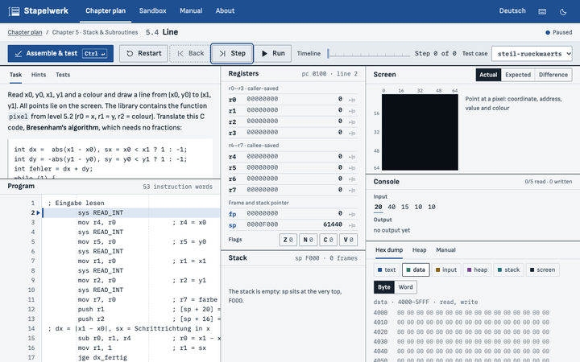
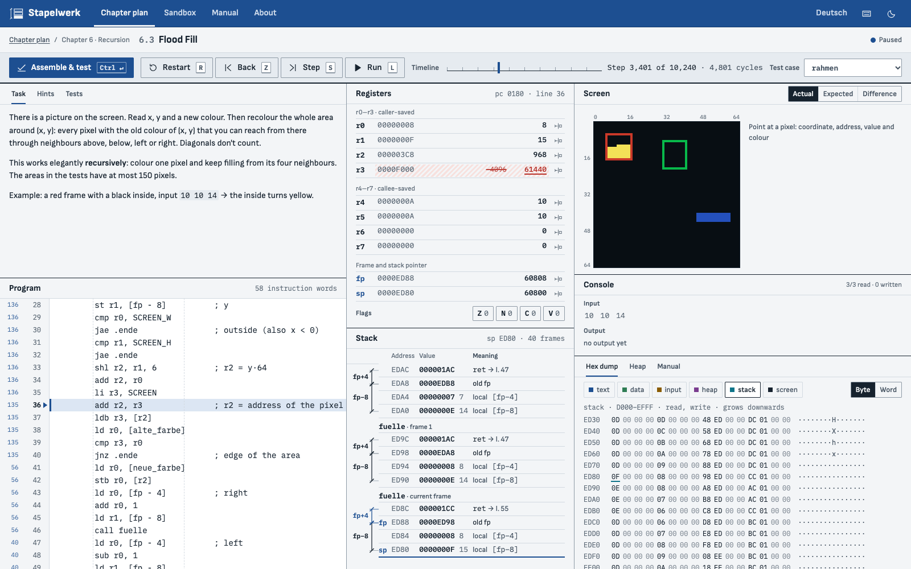
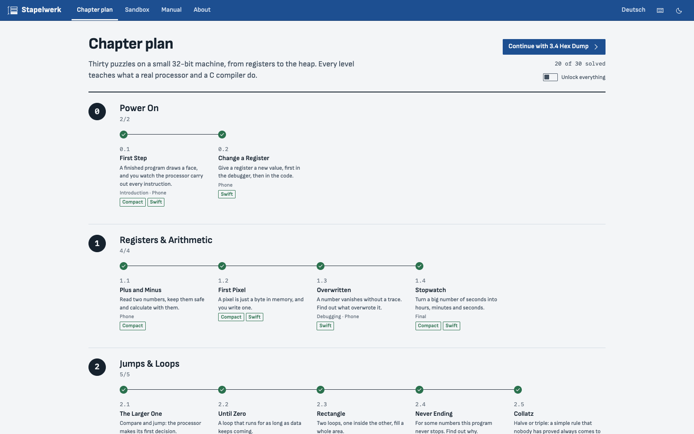
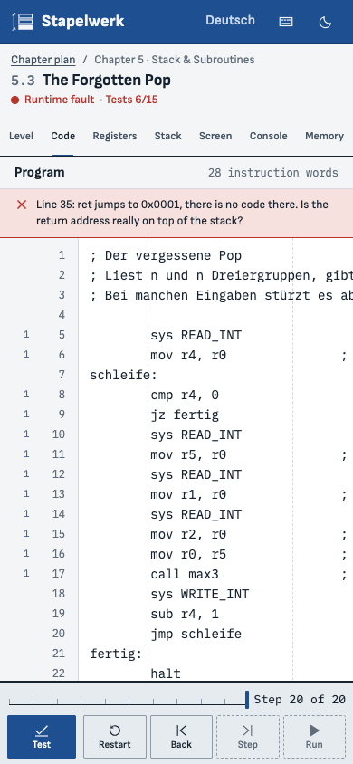

# Stapelwerk

**Assembly puzzles in the browser, on a small 32-bit CPU of its own.**

Thirty puzzles in eight chapters take you from changing one register to linked lists on the heap. You write assembly, run it against tests and step through it in a debugger that can also go backwards. Every level ends with what a real x86, ARM or RISC-V processor and a C compiler do in the same situation.

[Deutsche Version → README.de.md](README.de.md)



**[▶ Play it in your browser](https://stefanpaun.page/stapelwerk/en/)** (no install, no account) · [German version of the game](https://stefanpaun.page/stapelwerk/)

- Runs in the browser, no account, nothing to install, works offline after the first visit.
- A home-made CPU written in Rust with zero third-party crates, compiled to WebAssembly.
- Vanilla JavaScript and hand-written CSS: no framework, no bundler, no npm packages.

## What you learn

Each chapter opens once the required levels of the chapters before it are solved. Bonus levels are optional.

| Chapter | Levels | Concepts |
|---|---|---|
| 0 · Power On | First Step · Change a Register | registers, program counter, step, step back, breakpoint |
| 1 · Registers & Arithmetic | Plus and Minus · First Pixel · Overwritten · Stopwatch | system calls, two-operand form, the screen as memory, integer division and remainder |
| 2 · Jumps & Loops | The Larger One · Until Zero · Rectangle · Never Ending · Collatz | `cmp`, flags Z/N/C/V, conditional jumps, loops, sentinel, nested loops, cycle budget |
| 3 · Bits & Numbers | Count the Ones · 8×8 Glyph · Half Truth · Hex Dump | masks, shifts, two's complement, logical vs. arithmetic shift, ASCII |
| 4 · Memory | Largest Value · Mirror · One Too Many · Sorting | data segment, arrays, base + index·4, alignment, little-endian, off-by-one |
| 5 · Stack & Subroutines | Backwards · Pixel Function · The Forgotten Pop · Line | push/pop, `call`/`ret`, return address, calling convention, caller- and callee-saved registers |
| 6 · Recursion | Factorial · Fibonacci Gone Wrong · Flood Fill · Towers of Hanoi | stack frames, frame pointer, prologue and epilogue, recursion depth, stack overflow |
| 7 · Heap & Lists | Chain Links · After Free · Sorted Insert | `ALLOC`/`FREE`, pointers, null, memory leaks, use after free |

Seven levels are **debugging levels**: the start code has a bug, and you find it with the debugger instead of by guessing. Every level has a task, three hints (from the idea to almost the solution), visible and hidden tests, and a "What you just learned" page. The full plan with learning goals is in [docs/CURRICULUM.md](docs/CURRICULUM.md).

## What you see

| | |
|---|---|
| **Editor** | Plain text editor with line numbers, breakpoints in the gutter, error marks with cause and position, and a counter per line showing how often it ran. |
| **Debugger with time travel** | Step, step back (even after a fault), run and pause, restart, a timeline to jump to any step already taken, breakpoints, and "back to the last change" of any register. |
| **Registers** | `r0`–`r7`, `fp`, `sp`, `pc` and the flags. What a step changed is hatched and underlined, with the old value struck through beside it. Values can be edited while paused. |
| **Stack with frames** | The stack as a table from the top down to `sp`, with the frame chain: old `fp`, return address, arguments, local variables. |
| **Screen** | The 64×64 screen with three views: actual, expected and difference (wrong pixels hatched). Point at a pixel to see its coordinate, address and colour. |
| **Hex dump** | All 64 KiB by segment, as bytes or words, with the heap fill patterns `CD`/`DD` visible. |
| **Heap map** | Every 4-byte granule of the heap as free, allocated, freed or red zone, plus a list of blocks with the line that requested them. |
| **Manual** | Eleven short topics (registers, instructions, flags, two's complement, memory, stack, calling convention, heap, screen, system calls, debugger), linked from the level texts. |
| **Sandbox** | A free program without a task, with interactive input and five examples. |
| **Share link** | A sandbox program travels compressed inside the link. Nothing is uploaded, and an opened link never runs by itself. |
| **Result** | Your cycles and size compared with the reference solution, two badges (Compact, Swift) and three slots per level to keep solutions. |

<p>
  
  
</p>



## For teachers

- No account, no sign-up, no data collection. Progress stays in the student's browser and can be exported as a file.
- Works offline once the page has been opened, and can be run from a local copy (see below).
- **Unlock everything** in the chapter plan opens all levels at once, for example to show one on a projector. Each level has its own link, such as `https://stefanpaun.page/stapelwerk/en/#/level/2-2-bis-zur-null`.
- The level files, including reference solutions and hidden tests, are public in this repository. Stapelwerk is a practice tool, not an exam tool.

## Run it locally

You need [rustup](https://rustup.rs) and Node 22 or newer. There is nothing to `npm install`. `rust-toolchain.toml` pins Rust 1.99.1 with the `wasm32-unknown-unknown` target; rustup installs it on first use.

```sh
git clone https://github.com/Stefan-Paun/stapelwerk.git
cd stapelwerk
npm start          # builds the core and the site, serves http://127.0.0.1:4860/stapelwerk/
```

The English version is at `http://127.0.0.1:4860/stapelwerk/en/`. Locally the service worker (offline mode) is off unless you add `?sw=1`.

```sh
npm test               # Rust tests and Node tests
npm run test:browser   # browser tests in headless Chrome (set CHROME_PATH if it is not found)
npm run check          # everything CI runs, with a summary
```

The command-line tool runs programs and levels outside the browser:

```sh
cargo run -q -p stapelwerk-cli -- run solution.s --level levels/2-2-bis-zur-null.lvl
cargo run -q -p stapelwerk-cli -- run solution.s --level levels/2-2-bis-zur-null.lvl --test grundfall --trace
cargo run -q -p stapelwerk-cli -- --help
```

## The machine

A teaching CPU designed for this game, small enough to understand in an afternoon:

- **Registers:** 10 × 32 bit, `r0`–`r7`, `fp` (frame pointer) and `sp` (stack pointer). The program counter cannot be named as an operand.
- **Flags:** Z, N, C, V. C after a subtraction means *borrow*, as on x86.
- **Instructions:** 47 mnemonics on 51 opcodes, each exactly one 32-bit word in one of four fixed formats. Decoding is strict: every valid word has exactly one meaning and one text form.
- **Faults are precise:** 23 named runtime faults (null access, misaligned word, stack overflow, use after free, …), each with an explanation in German and English.
- **Screen:** 64×64 pixels, one byte per pixel at `0xF000`, 16 named colours.
- **System calls:** 8 (`READ_INT`, `WRITE_INT`, `READ_CHAR`, `WRITE_CHAR`, `WRITE_STR`, `ALLOC`, `FREE`, `RAND`).
- **Deterministic:** no floating point, no clock, randomness only from seeds.

| Segment | Addresses | Rights |
|---|---|---|
| null | `0x0000`–`0x00FF` | none (catches null pointers) |
| text | `0x0100`–`0x3FFF` | read, execute |
| data | `0x4000`–`0x5FFF` | read, write |
| input | `0x6000`–`0x7FFF` | read, write (test input) |
| heap | `0x8000`–`0xBFFF` | only through `ALLOC`, checked |
| guard | `0xC000`–`0xCFFF` | none |
| stack | `0xD000`–`0xEFFF` | read, write, grows down from `0xF000` |
| screen | `0xF000`–`0xFFFF` | read, write |

Full specification: [docs/ISA.md](docs/ISA.md) and the generated [instruction table](docs/isa-table.md). How it maps to real processors (registers, calling conventions, flags, corner cases): [docs/TO-REAL-CPUS.md](docs/TO-REAL-CPUS.md).

## How it works

```
levels/*.lvl ──┐
player code ───┤
               ▼
   Rust core (crates/core, zero third-party crates)
   assembler · machine (CPU, memory, heap, system calls)
   session (debugger, time travel) · runner (tests, metrics)
               │
               ▼
   WebAssembly (crates/wasm: C ABI, 42 functions, no imports, about 205 KiB)
               │
               ▼
   web/js/vm.js (the only module that touches WebAssembly)
               │
               ▼
   views: editor, registers, stack, screen, hex dump, heap map, tests
```

The core is about 21 000 lines of Rust including its tests. Time travel keeps snapshots of the machine and replays from the nearest one, so stepping back stays fast even after millions of steps. The build packs the levels for the web (`stapelwerk pack-levels`): the reference solution is removed, its cycle count and size are kept for the result page. The interface is around 6 400 lines of vanilla JavaScript in ES modules.

**How it is tested:**

- Over 200 Rust tests: encoding vectors, ALU vectors and a random ALU model, assembler golden files, disassembly round trips, no panic on corrupted input, the time-travel invariant over hundreds of thousands of steps, every fault and every check message. CI also runs an exhaustive test over all 2³² instruction words.
- Over 90 Node tests: the WebAssembly interface (exact export list, no imports, size limit), `vm.js`, and the interface logic (i18n completeness, contrast, keyboard, router, progress, markup).
- A **differential test**: generated programs run natively and in WebAssembly, and the machine state is compared every 1000 steps (50 programs locally, 300 in CI).
- A **mutation test** of all levels: every instruction of every reference solution is deleted in turn, and some test must fail. Currently 550 of 550 deletions are caught (12 lines marked as pure optimisations are skipped).
- **Browser tests** drive headless Chrome over the DevTools protocol, without npm packages: playing levels with the keyboard only, five screen sizes, offline mode, shared links and XSS probes.

## Honest limits

- The CPU is invented. It has no pipeline, no caches and no interrupts, so it says nothing about performance on real hardware. What the levels say about x86, ARM and RISC-V is meant to be correct, but it is a simplified picture.
- Reference solutions and hidden tests are public in this repository, and the hidden tests also ship with the published level files. Anyone can look them up.
- On a phone, only some levels are comfortable to play (eleven are marked as phone-friendly). The workspace is built for a laptop screen.
- Automated tests run only in Chromium (headless Chrome). Firefox and Safari are not tested automatically.
- The levels and texts were written by AI agents and checked by tests and review, but not yet reviewed by teachers or tried in a classroom.

## Privacy

- No cookies, no analytics, no tracking, no requests to other servers. The fonts are self-hosted, and a strict Content-Security-Policy allows only the site's own files.
- Progress, solutions and settings stay in your browser's local storage. They leave your device only if you export them yourself.
- A share link carries the code in the part after `#`, which browsers do not send to the server.
- The site is hosted on GitHub Pages. As the host, GitHub sees your IP address and the usual request data, like any web server does.

## Accessibility

Everything can be played with the keyboard. `?` shows this table in the game:

| Key | Action |
|---|---|
| `S` | execute one step |
| `Z` | one step back |
| `L` | start or pause a run |
| `R` | restart the test case |
| `B` | breakpoint at the current line |
| `T` | show the tests |
| `?` | keyboard shortcuts |
| `Ctrl`/`⌘` + `Enter` | assemble and test |
| `Ctrl`/`⌘` + `S` / `B` | step / breakpoint while typing in the editor |
| `Esc` | leave the editor (`Tab` inserts a tab inside it) |

Letter shortcuts rest while you type.

- **Screen readers:** a live region announces every debugger step (line, instruction and what changed); the stack is a real table; register values carry labels including the old value; the hex dump is a table; assembler errors are announced.
- Skip link, visible focus, contrast checked by a test, `prefers-reduced-motion` and `forced-colors` respected. Changes are never shown by colour alone (hatching, underline, strike-through).

**Known gaps:**

- The 64×64 screen and the heap map are pictures. A screen reader gets a summary (how many pixels are set or wrong, how many blocks are live), not the picture itself; the pixel details on hover need a mouse.
- The editor is a plain text field without spoken syntax hints.
- Nobody who relies on a screen reader has tested it yet. Feedback is very welcome.

## How this was built

I'm Stefan, 17, a student in Vienna. I wanted a game that explains what really happens inside a processor, somewhere between the model computers we use at school and the tools used at university.

The idea, the choice of topics, the chapter plan and the decisions along the way are mine, and I accepted or sent back every step. The code, the levels and the texts were written by Claude Code agents (Claude Opus) from a written specification. Their work was checked several times: by separate review agents that had not written it, and by the automated checks above (over 200 Rust tests, over 90 Node tests, a differential test of native against WebAssembly, and a mutation test that catches all 550 deletions in the reference solutions).

That is a lot of checking, but it is not a guarantee. Mistakes are possible, in the code and in the texts. If you find one, please [open an issue](https://github.com/Stefan-Paun/stapelwerk/issues).

## Contributing

Bug reports, level ideas and pull requests are welcome. Rules (no third-party crates, no npm packages, every text in German and English) and a step-by-step "Add a level" guide are in [CONTRIBUTING.md](CONTRIBUTING.md). Security problems: please report them privately, see [SECURITY.md](SECURITY.md).

## Credits

Fonts: [Sofia Sans](https://github.com/lettersoup/Sofia-Sans) (The Sofia Sans Project Authors) and [IBM Plex Mono](https://github.com/IBM/plex) (IBM Corp.), both under the SIL Open Font License 1.1 and self-hosted in `web/fonts/` with their licence files.

## License

[MIT](LICENSE) © 2026 Stefan Paun
